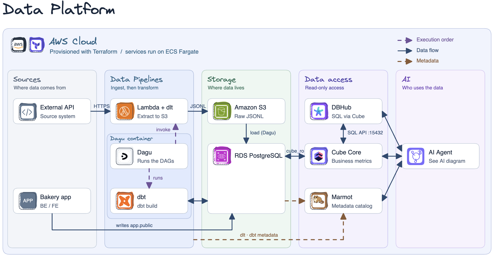
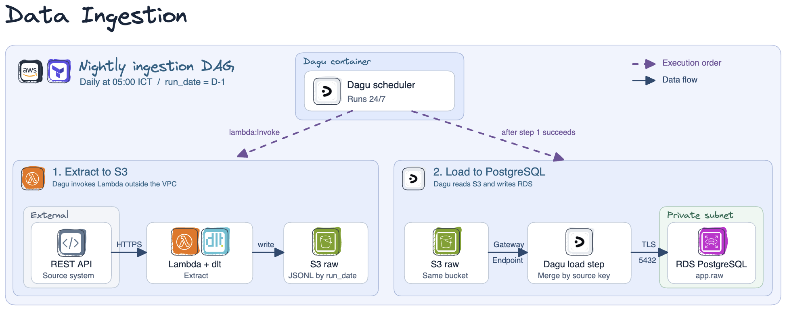
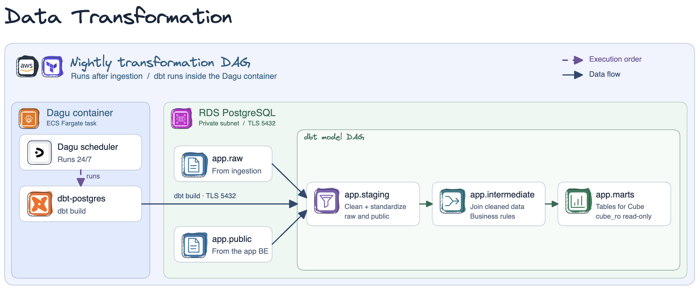
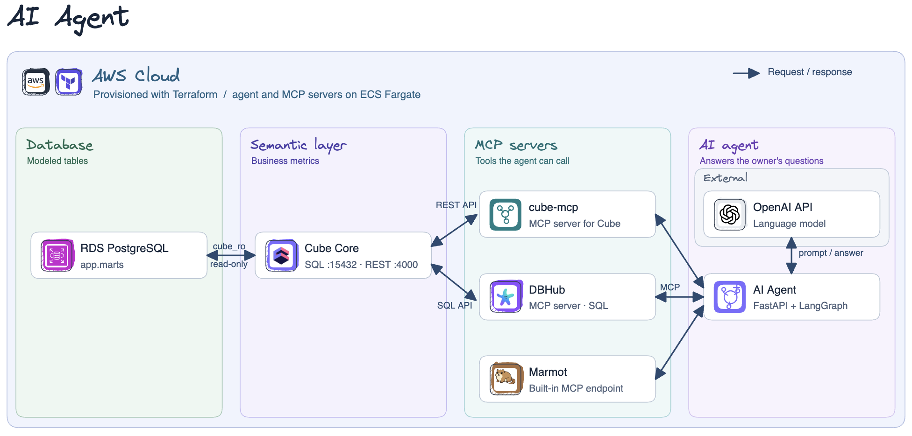

# Bakery Data Platform – Phase 1

A minimal AWS data platform for a newly opened bakery. It provides **morning business reports** and an **AI assistant** for the owner, for about **$27/month** plus LLM usage.

> Learning project. The bakery's sales app (BE/FE) and its base infrastructure (VPC, RDS, ALB, domain) are assumed to exist already. The data platform is built on top of them.

<!-- IMAGE: Data Platform (overview) -->

---

## Requirements

- **Morning reports** for the owner (sales, branches, channels, products, inventory, waste). Yesterday's data (T-1) is fresh enough.
- **Ask questions in natural language** and get charts back. There is one user, and slow responses are acceptable.
- **Ingest one external API** in addition to the app's PostgreSQL data.
- A **data catalog** and a **semantic layer**, so the AI understands the data and queries it safely.

**Constraints:**
- The data volume is tiny. Optimize for small scale and do not design for large scale yet.
- Make use of the AWS free tier and the shared infrastructure.
- One data engineer runs the platform.
- Have no impact on the sales app.

## Current state

| Existing (shared with the sales app) | Data platform (code ready, runs on docker-compose) |
|---|---|
| VPC, subnets, RDS PostgreSQL (OLTP), domain, ALB, ECR | Dagu, dbt-postgres, dlt, Cube, Marmot, DBHub, Cube MCP, AI agent (FastAPI + LangGraph), chat web UI (Next.js) |

## Solution

### 1. Ingestion: API → S3 → PostgreSQL

Every day at 05:00 ICT, with `run_date` = the previous day in ICT. Bread is baked fresh daily and nothing is sold after closing, so yesterday is complete by 05:00:
1. Dagu invokes **Lambda + dlt**, which runs outside the VPC, to pull from the API and write JSONL to **S3**.
2. Dagu reads S3 through the **S3 Gateway Endpoint** and merges the data into `app.raw`.

<!-- IMAGE: Data Ingestion -->

### 2. Transformation: dbt on RDS

dbt runs **inside the Dagu container**, but PostgreSQL does the actual compute. Models flow `raw` + `public` → `staging` → `intermediate` → `marts`.

<!-- IMAGE: Data Transformation -->

### 3. AI Agent

The owner signs in to the web UI through the ALB with Cognito. The agent uses **OpenAI** and calls tools over **MCP**:
- **Marmot** for business context.
- **DBHub** for curated reports and read-only SQL, through Cube's SQL API.
- **cube-mcp** for semantic queries.

The AI only reads `marts`, using a read-only database user.

<!-- IMAGE: AI Agent -->

### Key decisions

| Decision | Why |
|---|---|
| Use the existing RDS as the transform engine (dbt-postgres, separate schemas) | The data is tiny and runs happen before opening hours, so a separate warehouse is not needed |
| Run all services in **one ECS Fargate task (ARM)**, 24/7 | One CPU/RAM allocation, one public IP and no OS patching. Cheaper than 7 separate services |
| Run dbt inside the Dagu container | Postgres does the heavy work, so Lambda or a separate RunTask is not worth it |
| Run Lambda **outside the VPC** for extraction, with S3 as the hand-off | Stays in the free tier, needs no NAT Gateway, and keeps raw data for replays |
| **No NAT Gateway**. Use the free S3 Gateway Endpoint; the task has a public IP and no inbound rules | Saves about $30/month |
| Reuse the **existing ALB** with Cognito; admin UIs only through SSM port forwarding | No extra ALB, and no admin ports exposed |
| AI reads only `marts`, through Cube and DBHub (read-only user with `statement_timeout`) | Protects the OLTP database and the raw data |
| Terraform with a single environment; secrets in SSM Parameter Store | Reproducible. The Parameter Store Standard tier is free |

### Estimated cost

| Item | ~ USD/month |
|---|---|
| Fargate 0.5 vCPU / 4 GB ARM, 24/7 | 22 |
| Public IPv4 | 3.65 |
| S3, EFS, ECR | ~1 |
| Lambda, SSM, CloudWatch Logs, SNS, Cognito | ~0 (free tier) |
| **Total** | **~27 + OpenAI** |

## Limits and next steps

This design is intentionally small-scale. These signals mean it is time to move on:

| Signal | Next step |
|---|---|
| dbt slows RDS down or runs into opening hours | Separate analytics RDS, or S3 + Iceberg + Athena |
| More AI users | Per-user access control and persistent chat history |
| Data needs to be fresher than T-1 | Intraday ingestion or CDC |
| Heavier jobs | Move them to ECS RunTask or AWS Batch |